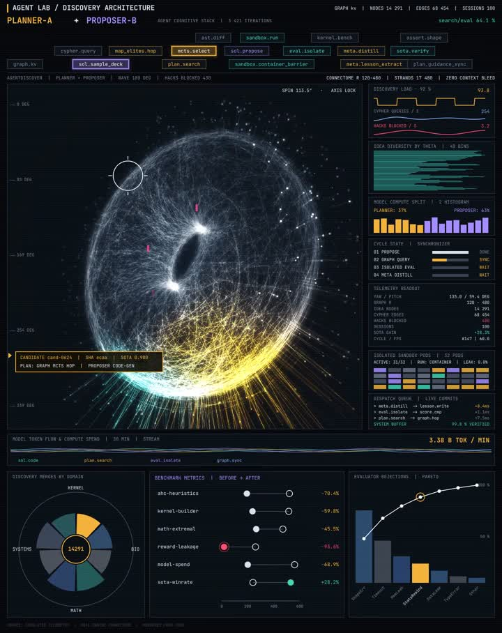

# Discovery Torus

This is a code-driven rebuild of a viral "AI lab discovery dashboard" clip: a spinning torus of glowing strands, framed by a dense sci-fi HUD.

**▶ [`discovery-torus.mp4`](discovery-torus.mp4)** · live version: `index.html`



## What the original actually is

The original is a 26 s, 720×908 portrait screen recording of a single web page. It is not a real system. There is no data behind it.

- **The centrepiece is a torus.** A few thousand curves (strands) run over its surface, drawn with additive blending, so wherever strands overlap the image gets brighter. The torus spins about a tilted axis, which makes the hole drift around the frame.
- **Highlight bands.** An amber band and a cyan band sweep around the ring by toroidal angle. Inside a band, the strands change colour and short radial "hairs", each with a dot at its tip, stick out of the surface.
- **Everything else is decoration** driven by sine waves and noise:
  - pipeline "chips" that light up in sequence;
  - oscilloscope traces, histograms and progress bars;
  - a rose chart whose highlighted sector rotates;
  - a before→after dumbbell chart;
  - a Pareto chart whose amber bar cycles through the bars;
  - ticking counters.
- **The numbers are flavour text.** They tick on timers.

## What this rebuild does better

| | Original | This rebuild |
|---|---|---|
| Resolution | 720×908, heavy compression | 1440×1816 master. Live page renders at your screen's DPR. |
| Torus | Canvas lines, soft and smeared | WebGL2: 1,900 strands × 140 segments and 800 hairs in one draw call. The torus shape is computed on the GPU. Two-radius additive bloom. |
| Determinism | Screen capture | Every frame is `renderAt(t)`, a pure function of time. The MP4 is rendered frame-exact through headless Chromium and does not drop frames. |
| Overlays | Static | The reticle, anomaly markers and annotations are projected with a JS twin of the vertex shader, so they stay attached to the torus as it moves. |
| Branding | Real lab name and an @handle | Neutral, fictional labels. Nothing here impersonates a real organisation. |

## Run / render

```bash
cd .. && python3 -m http.server   # then open http://localhost:8000/discovery-torus/
node render.mjs --stills 0,5,9    # PNG stills -> out/
node render.mjs                   # 12 s @ 30 fps -> discovery-torus.mp4  (DURATION, FPS env vars)
```

Requires Playwright with Chromium, and ffmpeg. Fonts are reused from `../string-theory/fonts`.

## Knobs (top of `index.html`)

- `STRANDS`, `SEG`, `HAIRS`: density.
- `R`, `r`: torus proportions. A bigger `r` gives a smaller hole.
- `scene(t)`: camera yaw/tilt, flow speed and band speeds.
- Strand alpha in the vertex shader. With additive blending this is the main brightness control.
