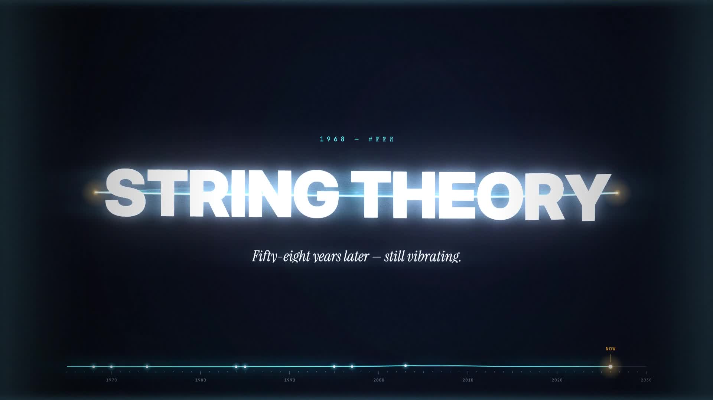

# STRING THEORY — a brief history in fifteen seconds

A 15-second, 1080p60 motion-graphics piece about the history of string theory.
Every frame and every sound comes from code: no stock footage, no samples, no After Effects.

**▶ [`string-theory.mp4`](string-theory.mp4)** · live, scrubbable version: `preview.html`



## The edit

| Time | Era | What you see | The physics behind it |
|---|---|---|---|
| 0.0–2.0 | Cold open | A point of light stretches into a string. It is pulled back (anticipation), released, and the title rides the wave, cut into 6 px strips displaced by the string. The string then drops to become the timeline. | Exact plucked-string solution: a triangle released at *x = p* and summed over 14 damped normal modes. |
| 2.0–3.5 | **1968** Veneziano | A 2→2 scattering diagram flips between s- and t-channel while the amplitude types itself out. Regge trajectories sit faintly behind. | *A(s,t) = Γ(−α(s))Γ(−α(t)) / Γ(−α(s)−α(t))*, Euler's beta function, and its s↔t duality. |
| 3.5–5.0 | **1970** Nambu · Nielsen · Susskind | The propagator (match cut) becomes a string and splits into five harmonics, with node markers and mass bars. | One string, many particles: modes *n = 1…5*, *M² ∝ n*. |
| 5.0–6.5 | **1974** Scherk · Schwarz · Yoneya | The fundamental curls (at constant length) into a closed loop. The loop oscillates as a quadrupole, + then × polarisation, over a warped, rippling spacetime sheet. A ring of test masses breathes with it. | The closed string's massless spin-2 state is the graviton. |
| 6.5–8.0 | **1984** First superstring revolution | Hard cut and flash. 240 E₈ roots unfold from a random 8D→2D projection and snap into perfect Coxeter-plane symmetry. "496" sits behind, D = 26 → 10 counts down, and the five superstring theories appear as chips. | Green–Schwarz anomaly cancellation needs a gauge group of dimension 496: SO(32) or E₈×E₈. |
| 8.0–9.5 | **1985** Calabi–Yau | Zoom-through into a rotating, shaded quintic Calabi–Yau. A powers-of-ten pull-back shows one of these "at every point of space". | Hanson's 2D slice of *z₁⁵ + z₂⁵ = 1*, as 25 patches, painter-sorted with Fresnel rim light. |
| 9.5–11.0 | **1995** Second revolution | Whip pan. The M-theory star diagram builds edge by edge, each labelled by its duality (S¹, S¹/Z₂, T, S, Ω), and *M* lands with a shockwave. | Witten, Hull, Townsend and Polchinski: five theories and 11D supergravity become limits of one theory. |
| 11.0–12.5 | **1997** Maldacena | The shockwave becomes the boundary of a {7,3} hyperbolic tiling that flows under a live Möbius transformation. A Ryu–Takayanagi geodesic draws itself across the disk. | AdS/CFT: bulk gravity equals a boundary quantum field theory, with *S = Area(γ)/4G*. |
| 12.5–13.5 | **2003** The landscape | A hidden-line ridgeline terrain flies past, with vacua glowing in its valleys while 10^N counts to 500. Everything then implodes to a point. | KKLT, Susskind, Bousso–Polchinski. |
| 13.5–15.0 | Outro | The point stretches into the string again (bookend). Final pluck, title, "Fifty-eight years later — still vibrating." | |

The design system holds throughout:

- **Year odometer:** each digit rolls on its own with carry, and is smeared when it moves fast.
- **Timeline:** the bottom ruler is itself a string. It gets *struck* (a velocity impulse, so it never pops) wherever the playhead lands.
- **Kicker labels:** they decode in like data.
- **Headlines:** masked, per-word staggered reveals.
- **Frame furniture:** figure captions, leader-line annotations, crop marks, chapter counter and timecode.

## Craft notes

- **Motion:** custom bezier "house" curves (`snap`, `swift`), under-damped springs and anticipation before every pluck. Match cuts go point → string → propagator → harmonics → loop. Other transitions are a zoom-through, a whip pan, ring → disk, disk → floor, and an implosion → point.
- **Lens:** the film uses real motion blur, made by accumulating 4 sub-frames per frame with a 180° shutter. On top of that:
  - two-scale bloom with a soft threshold;
  - an anamorphic streak;
  - radial chromatic aberration, driven by impacts, the pre-cut tension and the whip velocity;
  - camera shake, flashes, a vignette and film grain.
- **Determinism:** every frame is a pure function of *t*. Frames render in parallel and the browser preview matches the master.
- **Sound** ([`audio/synth.py`](audio/synth.py), numpy only):
  - Every melodic sound is a Karplus–Strong plucked string, so the score is literally made of vibrating strings.
  - The odometer ticks once per year rolled.
  - A riser builds into the 1984 cut, and sub drops land on each impact.
  - Each era plucks the next note of a rising D-minor arpeggio. The outro resolves to D *major*.
  - Convolution reverb uses a synthetic impulse response, and the mix ducks under the hits.

## Build

```bash
npm install            # @napi-rs/canvas (Skia)
./build.sh             # score + parallel render + H.264/AAC master  (JOBS, SAMPLES env vars)
node render.mjs --stills 2.9,7.4,8.6 --samples 1   # quick PNG stills -> out/stills
python3 -m http.server && open http://localhost:8000/preview.html
```

Requires Node 22+, Python 3 with numpy, and ffmpeg. E₈ data is precomputed by
`tools/e8.py`. Fonts are bundled in `fonts/` (all SIL OFL): Inter Display, Instrument Serif, JetBrains Mono and STIX Two.

```
src/engine.js    easing, springs, noise, colour, plucked/struck strings, kinetic type
src/timeline.js  the edit: eras, hits
src/scenes.js    intro, 1968 … 2003, outro
src/hud.js       timeline string, odometer, text blocks, frame furniture
src/film.js      cameras, sub-frame motion blur, lens/post
render.mjs       Node renderer -> ffmpeg
audio/synth.py   the score
```
